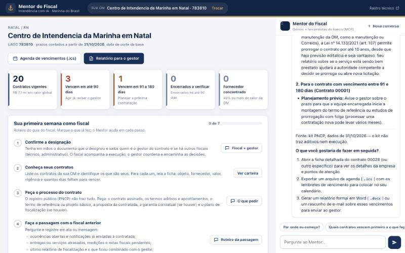

# Mentor do Fiscal · Hackathon C-ApA-IM · Desafio 4

1º Hackathon "Intendência com IA!" (CIANB, 26–27/11/2026) · **Equipe 4 — Gestão e Acompanhamento de Contratos**

> **Ninguém fiscaliza sozinho.** Um mentor de IA para o oficial recém-designado fiscal de contrato: o que é dele, o que vence e o que fazer agora.



**Problema.** Um oficial acaba de ser designado fiscal de contrato e nunca fiscalizou. Ele não sabe quais contratos são seus, o que o fiscal anterior deixou, o que vence e o que precisa cobrar. A cada troca de função, o novo fiscal recomeça do zero.

**Solução.** Uma tela web com o painel da OM (direto do banco) e um agente de IA (Google ADK + Gemini) que conversa com o fiscal em português, consulta a base de contratos do PNCP fornecida pela organização e o ensina, passo a passo: quais são os contratos, o que diz cada um, o que vence, o que pedir na passagem de fiscalização. E gera o relatório em Word, o e-mail ao gestor e a agenda de vencimentos.

## Rodar em 3 passos (Windows, macOS ou Linux)

Pré-requisitos: **Docker Desktop aberto** e uma **chave gratuita do Gemini** (https://aistudio.google.com/apikey).

1. Baixe o projeto:
   ```
   git clone https://github.com/nicholasmfes/hackathon-contratos-ia.git
   cd hackathon-contratos-ia
   ```
2. Crie o `.env` a partir do exemplo (`copy .env.example .env` no Windows, `cp .env.example .env` no macOS/Linux). Abra o `.env`, troque as quatro senhas (qualquer texto com letras e números) e cole a chave em `GOOGLE_API_KEY`.
3. Suba tudo:
   ```
   docker compose up -d --build
   ```
   Na primeira vez leva de 3 a 10 minutos (download das imagens e carga do kit). Acompanhe com `docker compose ps` até `hk-db` ficar `healthy`.

Depois abra **http://localhost:8090**, clique em **"Centro de Intendência da Marinha em Natal"** e siga um dos roteiros abaixo.

| Endereço | O que é |
|---|---|
| **http://localhost:8090** | **Tela do fiscal**: painel da OM e conversa com o Mentor |
| http://localhost:8000 | Rastro técnico do agente (Google ADK): escolha `mentor_fiscal` e veja cada evento |
| http://localhost:8080/saude | Teste sem IA: deve mostrar `"contratos_no_banco": 16946` |
| http://localhost:3000 | Metabase (opcional, para painéis do comando) |

### Se algo der errado

- **Porta ocupada:** acrescente `DB_PORTA=5433` (banco) ou `WEB_PORTA=8091` (tela) no `.env` e rode `docker compose up -d` de novo.
- **Gemini sobrecarregado (503) ou limite de uso (429):** troque `MODELO_GEMINI` no `.env` (por exemplo `gemini-2.5-flash`) e rode `docker compose up -d agente`. O painel da tela continua funcionando sem o Gemini.
- **Reiniciou ou reconstruiu o `mcp`?** Reinicie também o agente (`docker compose restart agente`): ele guarda a sessão MCP antiga e passa a responder sem ferramentas (erro `MALFORMED_FUNCTION_CALL`).

## O que a tela do fiscal mostra

1. **Escolha da OM** por nome, cidade ou UASG (atalhos para a demonstração).
2. **Painel da OM**, direto do banco e sem IA: contratos vigentes e valor, quantos vencem em até 90 e em 91–180 dias, encerrados a verificar e fornecedor concentrado.
3. **Sua primeira semana como fiscal**: o roteiro do guia (`primeiros_passos`) com checklist e, em cada passo, um botão que pede ajuda ao Mentor ou baixa a agenda.
4. **Carteira** ordenada pelo vencimento, com busca; o clique abre a **ficha do contrato** (prazo, objeto, valores, pontos de atenção, o que não consta na base) com os botões "Explicar com o Mentor", "Relatório em Word", "Agenda (.ics)" e "Ver no PNCP".
5. **Alertas** da OM.
6. **Mentor** (chat): a resposta aparece enquanto é escrita; cada consulta ao banco aparece como etapa (clique para ver os parâmetros ou o SQL); relatório em Word, agenda e e-mail ao gestor viram cartões com "Baixar" ou "Copiar". A conversa continua depois de recarregar a página.

## Roteiros de demonstração (fiscal recém-designado)

Na tela do fiscal, abra o Centro de Intendência da Marinha em Natal (UASG 783810: 20 contratos vigentes, 3 vencem em até 90 dias) e escreva as frases no chat, na ordem, ou use os botões do painel.

**Roteiro 1 — "Cheguei: quais são meus contratos?"** (conhecer a carteira)
1. `Olá, fui designado fiscal de contrato e nunca fiscalizei. Por onde começo?`
2. `Quais contratos a minha OM tem vigentes?`
3. `Quais vencem primeiro e o que eu preciso fazer com cada um?`
4. `Exporte esses vencimentos para a minha agenda.` → baixa o .ics

**Roteiro 2 — "Herdei um contrato: o que o fiscal anterior deixou?"** (entender um contrato)
1. Na carteira, abra o contrato **00028** e clique em **"Explicar com o Mentor"**.
2. `O que o fiscal anterior fez nesse contrato?` → o Mentor diz que o kit não traz isso e lista o que pedir na passagem
3. `Ele vence em 7 dias. O que eu faço agora?` → passo a passo de vencimento (guia + ficha)
4. `Gere um relatório em Word desse contrato para eu levar ao gestor.` → baixa o .docx

**Roteiro 3 — "Preciso cobrar e avisar o gestor"** (agir)
1. `Quais alertas a minha OM tem hoje?`
2. `A empresa atrasou uma entrega. Como eu registro e cobro?` → guia de ocorrências
3. `Escreva um e-mail ao gestor avisando dos contratos que vencem em até 180 dias e do que precisa ser decidido.` → texto pronto para copiar
4. `Na Marinha, quantos contratos de serviços estão vigentes?` → consulta livre (o SQL aparece na etapa)

Cada chamada de ferramenta aparece como etapa no chat (e, com mais detalhe, na interface do ADK em http://localhost:8000): é a prova de que os números vêm do banco.

## Arquitetura

```
Fiscal ─► Tela do Mentor do Fiscal (http://localhost:8090, nginx: web/)
            ├─ Painel da OM ── /api/dados/* ── mesmas funções das ferramentas, SEM IA (abre na hora,
            │                                   funciona mesmo com o Gemini fora do ar)
            └─ Chat ── /api/agente/run_sse (streaming) ──┐
Interface técnica do Google ADK (http://localhost:8000) ─┤  rastro completo de cada evento
            ┌────────────────────────────────────────────┘
            └─ Agente "mentor_do_fiscal" (Gemini) ── escolhe a ferramenta e escreve os textos
                  └─ MCP (http://mcp:8080/mcp) ── servidor de ferramentas do sistema
                        ├─ buscar_om · meus_contratos · ficha_contrato · listar_alertas
                        ├─ guia_do_fiscal (passo a passo conferido, Lei 14.133/2021)
                        ├─ gerar_relatorio (Word ou texto de e-mail) · exportar_agenda (.ics)
                        └─ consultar_sql (só leitura)
                              └─ PostgreSQL, schema painel (views sem dado pessoal, usuário agente_ro)
Metabase (http://localhost:3000) continua disponível para painéis.
```

- **Quem calcula é o banco; a IA explica e escreve.** Nenhum número sai do modelo.
- **MCP**: as ferramentas do sistema viram um servidor MCP padrão; qualquer agente compatível pode usá-las.
- **Resiliente**: o painel usa as mesmas funções das ferramentas sem passar pela IA, então continua de pé se o Gemini cair.
- **Seguro por padrão**: tudo publicado só em `127.0.0.1`; a tela e o agente ficam no mesmo endereço e a proteção de origem do ADK continua ativa.

## Dados e privacidade

- **Base:** o kit do PNCP fornecido pela organização (`dados/kit/`), congelado em **31/10/2026**: 16.946 contratos e empenhos da Marinha e 1.494 unidades compradoras.
- **Pessoa física (Art. 5º do regulamento):** nas 204 linhas de pessoa física o nome foi apagado antes de versionar e o CPF já vinha mascarado. O agente lê o banco só pelas views do schema `painel` (sem CPF e sem nome de pessoa física), com o usuário `agente_ro`, só de leitura e com limite de tempo por consulta.
- **Revisão humana (Art. 2º):** resumos, relatórios e orientações saem marcados como subsídio gerado com apoio de IA.

**A dor em números** (só contratos, referência 31/10/2026):

| Indicador | Quantidade |
|---|---|
| Contratos vigentes | 2.894, em 194 OMs (R$ 4,27 bilhões) |
| Vencem em até 90 dias | 479 |
| Vencem em 91 a 180 dias | 367 |
| Encerrados há até 90 dias, sem reposição confirmada | 517 |
| OMs com um fornecedor concentrando 40% ou mais do valor | 112 |

**Views do schema `painel`:**

| View | Grão | Para quê |
|---|---|---|
| `painel.vw_contratos` | 1 contrato ou empenho | Dados tipados: dias para vencer, situação, faixa de vencimento, verificar reposição, contrato × empenho, qualidade do dado |
| `painel.vw_concentracao` | OM × fornecedor | Participação do fornecedor (CNPJ raiz) no valor vigente da OM, HHI da OM e alerta de concentração |
| `painel.vw_concentracao_marinha` | fornecedor | Valor vigente na Marinha inteira, OM atendidas e participação no total |
| `painel.vw_alertas` | 1 alerta | Lista única: vence em até 90 dias, vence em 91 a 180, encerrado há até 90 dias, fornecedor concentrado, qualidade do dado |
| `painel.parametro` | 1 linha | Data de referência e limiares dos alertas |

**Data de referência:** os prazos contam a partir de 31/10/2026 (`painel.parametro.data_referencia`). Contar a partir de hoje marcaria como vencido o que pode ter sido prorrogado depois do corte, porque o kit não traz aditivos. Em produção, a referência passa a ser `CURRENT_DATE`.

**Conferência com o kit real:** a regra de vigência das views bate com a marca `vigente_na_data_corte` da organização em **16.917 de 16.917 instrumentos (100%)**.

## Limitações

- O kit não traz aditivos, prorrogações, execução, pagamentos nem o nome dos fiscais: um contrato prorrogado pode aparecer como encerrado. Por isso o alerta diz "verificar reposição", e não "vencido sem reposição".
- Alertas são sinais para verificar, nunca conclusão de irregularidade.
- Resumos, relatórios e orientações são subsídio e precisam de revisão humana.
- No plano gratuito do Gemini, o Google pode usar o conteúdo enviado para melhorar seus produtos: por isso só dado público do kit, sem pessoa física, sai do sistema.

## Estrutura do repositório

| Caminho | O que é |
|---|---|
| `docker-compose.yml` | Os cinco serviços: banco (`db`), ferramentas (`mcp`), agente (`agente`), tela (`web`) e Metabase |
| `web/` | Tela do fiscal (HTML, CSS e JS sem bibliotecas externas) e o `nginx.conf` que a serve |
| `agente_adk/` | Agente do Google ADK (`mentor_fiscal`) com Gemini |
| `mcp_server/` | Servidor MCP com as 8 ferramentas, o guia do fiscal (`guia_fiscal.md`) e a API do painel |
| `db/init/` | Carga automática do kit e views do schema `painel` |
| `dados/kit/` | Kit do PNCP usado pelo sistema (`contratos.csv`, `unidades.csv`) |
| `docs/` | Screenshot da tela e o registro da [versão anterior](docs/versao-anterior.md) (LangChain + Metabase) |
| `agente/`, `notebooks/` | Código da versão anterior e lógica de vencimento e concentração em pandas |

## Equipe 4

1ºTen (IM) Moraes Ferreira · 1ºTen (IM) Mattos · 1ºTen (IM) Ana Santiago · 1ºTen (IM) Eliézer · 1ºTen (IM) Coelho · 1ºTen (IM) Matheus Esteves

A lógica de vencimento, de concentração e as regras de dados vêm do **SIDEC-MB** (trabalho de MPI), adaptadas à base do hackathon.
